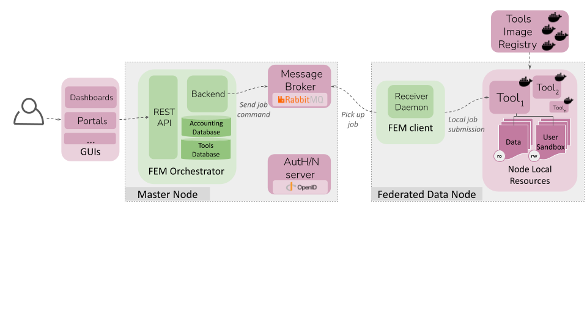

# Federated Execution Manager (FEM) - Client

The Federated Execution Manager (FEM) is a software component designed to coordinate and manage the execution of distributed processes in a federated leaning (FL) or decentralised compute environment where multiple devices or clients, i.e. the federated data nodes (FDN) provide compute and data resources.

# What is FEM?

FEM is responsible for controlling and orchestrating the lifecycle of the federated tasks. It consists of two parts:
- an **orchestrator module** (FEM-orchestrator) that ensures tasks reach the multiple FDNs in a secure and coordinated manner
- a **client module** (FEM-client) installed at the participating FDN that pulls such tasks and allocates them in the local infrastructure.

In short, the *FEM-client* interact with the FEM-orchestrator via a message broker (RabbitMQ) and pulls the federated task details.   across multiple Federated Data Nodes (FDNs). The FEM Client works in conjunction with the central FEM Orchestrator to manage distributed computing workflows, such as federated learning (FL) experiments and other data processing tasks.



## What is FEM-client?
The key functions of the FEM client include:
- **Task reception**: it ensures secure interactions between the FDN and the central orchestrator via a message broker (RabbitMQ) and pulls the federated task details.
- **Task stage-in**: it prepares the working enviroment, handling data volumes, container image pulling and source code Git syncronizations.
- **Task execution**: it executes tasks in the local infraestructure delegating the resources managment the customizable executors or launchers. Default executor: "docker".
- **Task stage-out**: it exchanging the necessary task outfiles and logging files with the central orchestrator.

## Prerequisites

For deploying either an FEM server or client, the minimal technical requirements are:
- Unix-based S.O. 
- Docker and Docker Compose
- 2CPUs and 4GB

> Please, consider that tools, pipelines or FL frameworks triggered by FEM have their on connectivity requirements.

The minimal client connectivity requirements to be part of an FEM-enabled federation are:
- Outgoing connection to RabbitMQ server
   - Default port: 5671 (AMQPS 1.0 over TLS)
   - Destination: FEM server IP or FQDN 

> Please, consider that tools, pipelines or FL frameworks triggered by FEM (e.g. Flower, etc) have their own connectivity requirements.

## Getting Started

1. Clone the repository:
`git clone https://gitlab.bsc.es/fl/fem-client.git`

2. Navigate to the project directory:
`cd fem-client`

3. Setup config file (clone the config repository that was shared with you and follow the instructions writen on its README file):
```
git clone https://gitlab.bsc.es/fl/{project_name}-fem-client-config.git
```
Once the config folder is set-up:

4. Start the Client
```
bash setup_service.sh
```

5. Monitor the receiver:
`docker logs -f fem-client`


## Installing FEM-client (from the image)

If the process fails during the 'docker build', there is an option to download the pre-built image of this project: 

1. Download the image from the docker registry. The credentials to log in are the same username and password used to access GitLab.
```
docker login gitlab.bsc.es
docker pull registry.gitlab.bsc.es/fl/fem-client:v2
docker logout #optional, if you don't want to keep logged in in this machine
```
2. Once the download is finished, check that docker can find ir with the following command:
`docker images`

If the 'registry.gitlab.bsc.es/fl/fem-client' is listed there, follow steps **1-5 of the 'Getting started' section**, and the docker-copose will run the project from the image instead of building it from scratch.


## Developing a Tool for FEM Executions

To integrate a tool (an analytical pipeline, an AI model predictor, etc.) with FEM-client, two main parts are required:

1. [Tool Packaging](#1-tool-packaging): The tool must be packaged as a **container**.
2. [FEM-Orchestrator Tool Registration](#2-fem-orchestrator-tool-registration): The tool must be added to the FEM-Orchestrator Database.


### 1. Tool packing

Consider the following points when building the Tool container:

##### Local Container Engine Compliance

FEM-client supports multiple container execution backends through launchers. Ensure your tool container is compatible with at least one of the following:


| Launcher | Description | Node Requirements | Tool Requirements |
| ------ | ------ |------ | ------ |
| Docker | **Default**. Interacts with Docker Client| Docker CE version 19.1 or greater | Docker container|
| [JobMan](https://github.com/chaimeleon-eu/jobman)  | A **Kubernetes** job manager | Jobman and K8s |Pod container and application|


##### Container Execution
- The tool must run non-interactively (no user input required at run time).
- Parameters must be passed as command-line arguments.
- The container must execute under the same UID:GID as FEM-client, ensuring that FEM-client can access and delete any files generated in the sandbox volume.

##### Data Handling
The FEM-client will trigger the Tool container with the following data volumes, although additional volumens can be specified in the database (see step 2):
- Data Volume (`data_path`): Mounted as read-only (ro). This contains input files provided by the federated node.
- User Sandbox Volume (`sandbox_path`): Mounted as read-write (rw). This is the working directory where the tool can write temporary and output files.
Any command-line arguments referring to files or directories should consider that paths must be inside these volumes.

##### Output & Logging
- The tool must write its results to the User Sandbox volume so FEM-client can retrieve them. Logs should be printed to stdout/stderr for proper monitoring.

##### Permissions & Execution Context
Since FEM-client runs under a specific UID:GID, ensure that:
- The tool does not create files as root inside the sandbox volume.
- The tool correctly sets file ownership and permissions to allow FEM-client to read and delete files post-execution.
- Use `chown` inside the container if necessary to set ownership correctly:
```
chown $(id -u):$(id -g) /sandbox/output-file.csv
```

- Avoid setting overly restrictive file permissions (e.g., `chmod 600`), as FEM-client needs to manage sandbox contents

##### Exit Behavior
The container should exit with a meaningful exit code, as FEM-client will gather it (`State.ExitCode`) from the container execution to properly detect and react to execution failures:
- 0 → Successful execution
- Non-zero → Execution failed (should provide relevant error messages)

##### Example Execution

```
docker run --rm \
  --user $UID:$GID \ # Run under the same UID:GID as FEM-client
  -v $DATA_PATH:/data:ro \
  -v $SANDBOX_PATH:/sandbox:rw \
  my-tool-image \
    --input /data/input-file.csv \
    --output /sandbox/prediction.json
    --my_threshold 33 


```
Where:

- `$DATA_PATH`: corresponds to the absolute path of o the datasets that the federated data node is allowing access to (e.g., images, clinical records, etc.). The container's mointing point (`/data` in the example above) can be freely setup to an static container path  according to tool's requirements. Yet, it should be latter on propery configured in the FEM-client database (see step 2). https://gitlab.bsc.es/fl/dt4h-fem-client-config#set-up-configuration-file
- `$SANDBOX_PATH`: corresponds to the absolute path of the folder where the results of that particular user execution run are expected to be created. The container's mointing point (`/sandbox` in the example above) can be freely setup to an static container path  according to tool's requirements. Yet, it should be latter on propery configured in the FEM-client database (see step 2).
- $UID and $GID: correspond to the (unprivileged) user id and the group id running the Tool container.

### 2. FEM-orchestrator Tool registration

Once the container image has been built and pushed to the project’s **container registry** (if required), it must be registered in the **FEM-Orchestrator Database**.

#### Tool Schema

| Resource | Description |
| -------- | ----------- |
| [FEM-tool-schema.json]() | JSON schema defining tool registration requirements |


A sample Tool registry document is provided below:

```json
{
  "_id": "tool_unique_identifier",
  "name": "tool_name",
  "author": "Your Name",
  "version": "1.0",
  "visibility": "public",
  "image": {
    "label": "registry.gitlab.bsc.es/namespace/tool_image_name:v2.0",
    "hash": "image_hash_value",
    "name": "tool_image_name",
    "repository": "registry.gitlab.bsc.es/fl/",
    "tag": "v2.0"
  },
  "port_mappings": [
    {
      "host_port": 4433,
      "container_port": 4433
    }
  ],
  "var_envs": {
    "FLOWER_CENTRAL_SERVER_IP": "flower.fl.bsc.es"
  },
  "volumes": [
    {
      "host_path": "$HOST_FEMC_PATH/config/rabbitmq-certificates",
      "container_path": "/app/config/rabbitmq-certificates"
    }
  ],
  "cpus": 4.0,
  "memory": "6gb",
  "gpus": "device=0",
  "persistent": false,
  "pre_checks": true,
  "source_code": {
    "url": "https://gitlab.bsc.es/project/repository.git --branch master"
  },
  "command": {
    "base": "python3 /app/myTool.py",
    "args": [
      {
        "id": "input",
        "type": "str",
        "default_value": "/data/input-file.csv",
        "position": 1,
        "prefix": "--",
        "separate": false,
        "required": true
      },
      {
        "id": "output",
        "type": "str",
        "default_value": "/sandbox/results.json",
        "position": 2,
        "prefix": "",
        "separate": false,
        "required": true
      },
      {
        "id": "my_threshold",
        "type": "int",
        "default_value": "33",
        "position": 3,
        "prefix": "--",
        "separate": false,
        "required": false
      }
    ]
  }
}

```


